# apps/mobile — 주차각 짝꿍 앱 (폰, PWA)

차량 앱과 **연결해서 쓰는 폰 앱**. 앱 설치 없이 웹 주소로 열리고, 홈 화면에 추가하면 앱처럼(PWA) 쓰고,
나중에 네이티브 앱이 **WebView로 감싸도** 그대로 동작한다. 연결하지 않은 폰도 차 화면 C-07의 링크(`/p/…#`, `/s/…`)로
주차 위치(M-01·M-02)를 바로 볼 수 있다.

- 디자인: `docs/design/M-10.dc.html` … `M-53.dc.html`, `M-01`·`M-02` (390×844), 메모 `canvas.json` → `ps1`~`ps4`
- API 계약: `packages/api-types/index.ts` (v1.1 절 + v1.2 주차왕 절), 설명 `docs/api.md`
- 스택: **Vite 8 + TypeScript + Preact 10** (JSX는 Vite 기본 변환기 — 플러그인 없음), 테스트 Vitest(+jsdom).
  런타임 의존성 `preact`, `jsqr`(QR 읽기, 필요할 때만 불러옴), `qrcode-generator`(`/dev/` 페이지만)

| M-10 시작 | M-13 차와 연결 | M-20 홈 | M-01 내 주차 위치 | M-02 돌아가는 길 |
|---|---|---|---|---|
| 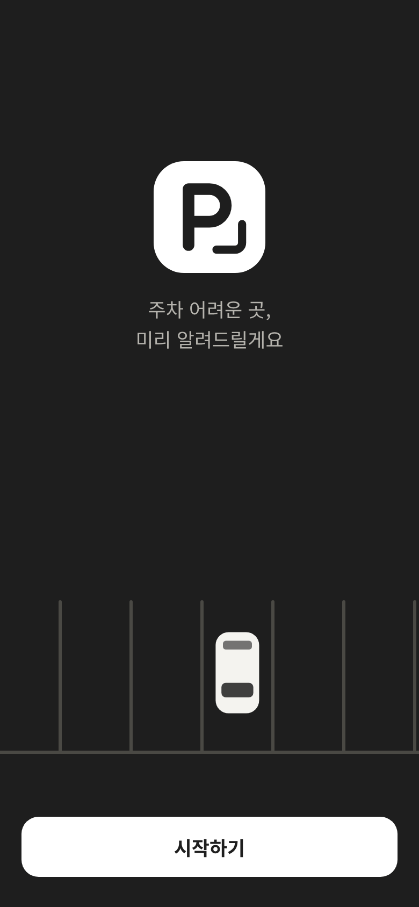 | 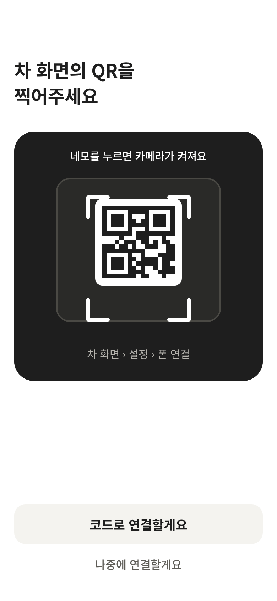 | 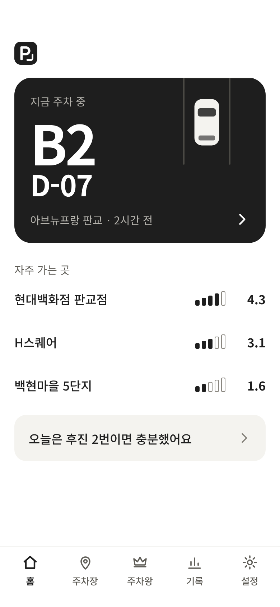 | 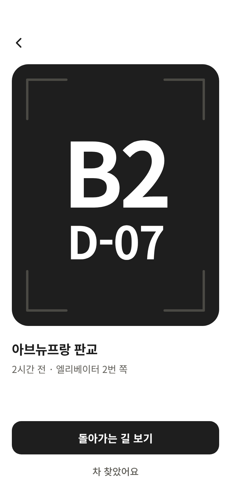 | 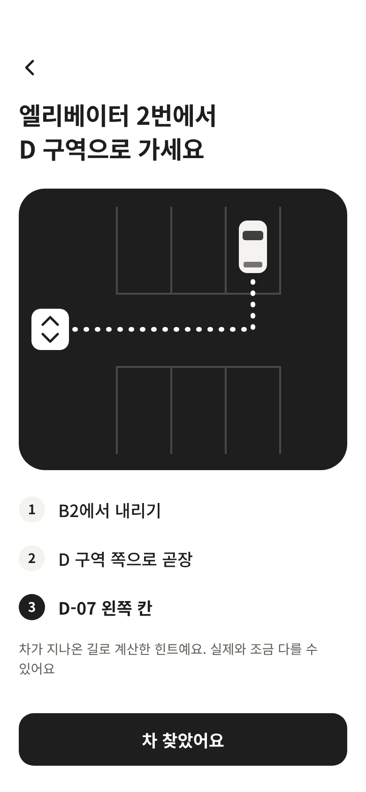 |
| **M-30 주차장** | **M-31 상세** | **M-32 기록** | **M-33 주차 동선** | **M-40 설정** |
| 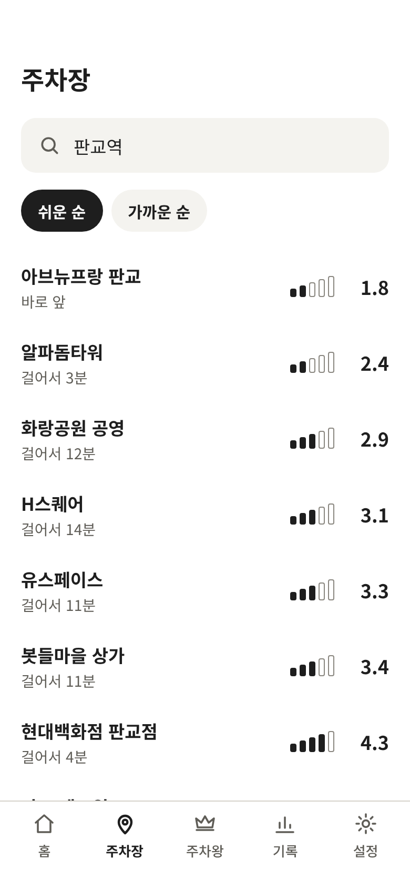 | 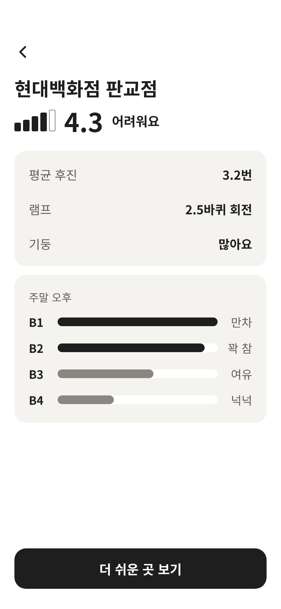 | 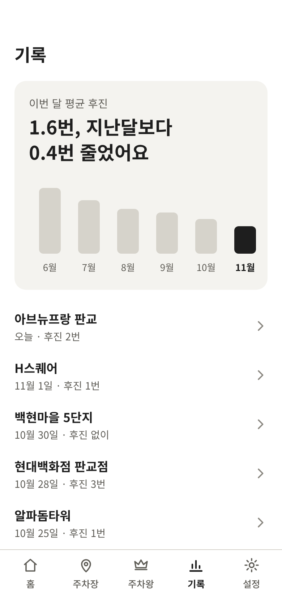 | 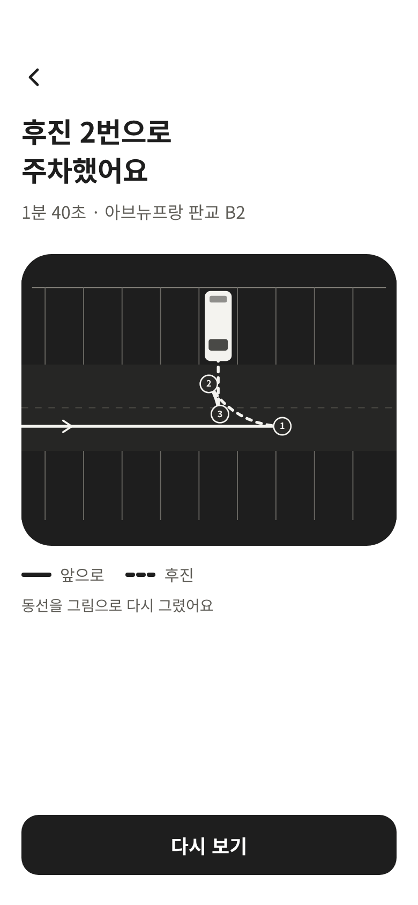 | 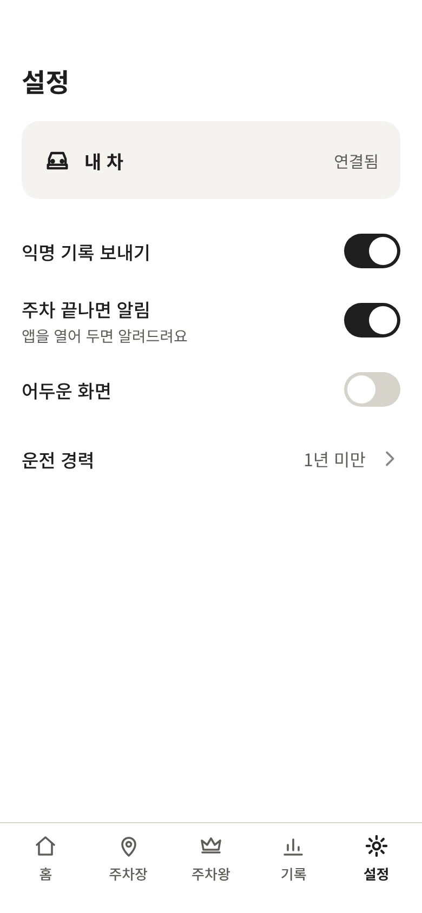 |
| **M-50 주차왕** | **M-51 내 점수** | **M-52 참여하기** | **M-53 주간 결과** | **공유 이미지 (PNG)** |
| 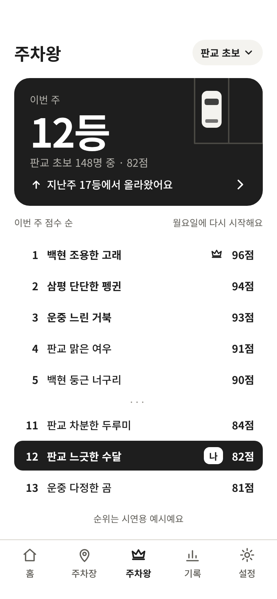 | 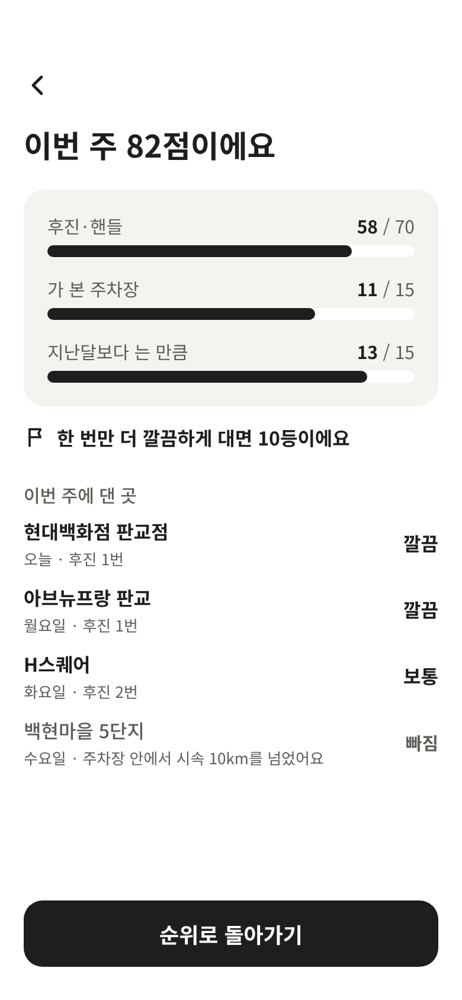 | 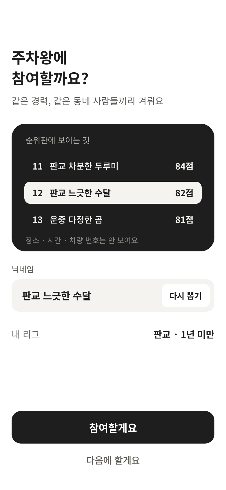 | 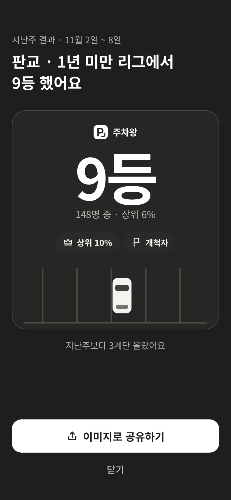 | 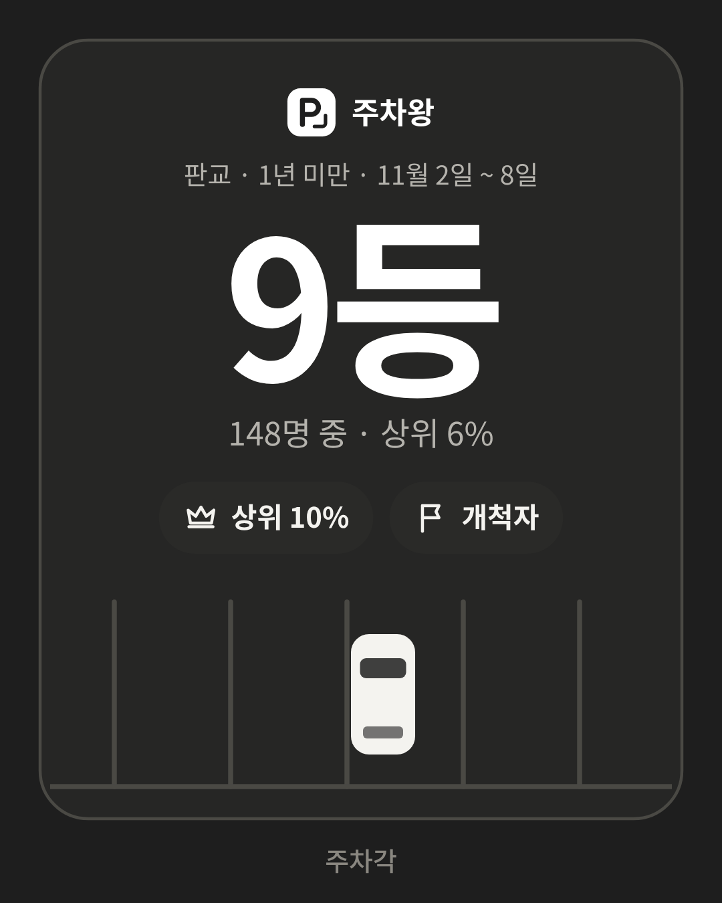 |

전체: `docs/screenshots/mobile/` (설명은 `docs/screenshots/README.md`). 움직임은 낱장 모음 `motion_home_parking.png`(홈 카드 주차),
`motion_push.png`·`motion_pop.png`·`motion_tab.png`·`motion_rise.png`(화면 전환).

## 화면과 흐름

| 경로 | 화면 | 하는 일 · 서버 호출 |
|---|---|---|
| `/start` | M-10 시작 | 시작하기 → M-11. 아래 **'시연 데이터로 둘러보기'**(PT용, `VITE_MOCK` 빌드에서는 숨김) → 서버 없이 시연 데이터로 홈 |
| `/start/spot` | M-11 주차 위치 | 다음 → M-12 |
| `/start/share` | M-12 익명 기록 동의 | 보낼게요 / 나만 볼게요 → 이 폰에 저장(`pg:pref:share`) → M-13 (이미 연결했으면 홈) |
| `/connect` | M-13 차와 연결 | 그림(QR 네모)을 누르면 **앱 안 카메라로 QR 찍기**. '코드로 연결할게요' → 코드 입력. '나중에 연결할게요' → 홈(연결 없이도 주차장·설정 사용) |
| `/connect/code` | 코드 입력 (새로 디자인) | 차 화면 숫자 6자리. 6자리가 차면 바로 `POST /v1/pairings/:code/claim` |
| `/pair/:code` | 연결 중 / 안내 | 차 QR(`${WEB}/pair/483920`)을 **기본 카메라 앱**으로 찍으면 여기로 → 바로 claim → M-14 |
| `/connected` | M-14 연결 완료 | 알림 받을게요(웹 푸시 구독 또는 폴링) / 나중에 → 홈 (M-12를 안 거쳤으면 M-12 → 홈) |
| `/` | M-20 홈 | 맨 위 '지금 주차 중' 카드(`GET /v1/me/parkings/current`, 30초마다) → M-01. 자주 가는 곳(`GET /v1/me/stats` favorites + `GET /v1/lots/:id`), 좋아진 것 한 줄(→ M-33/M-32). 연결 전이면 '차와 연결할게요' 카드 + 판교역 근처 주차장 |
| `/parking` · `/parking/way` | M-01 · M-02 | 큰 층·구역, 경과, 메모 → 돌아가는 길(힌트 `hints` 3단계 + 그림 `route`) → **차 찾았어요** `POST /v1/me/parkings/:id/found` → 홈은 '주차하면 여기에…' |
| `/p/:id#payload` · `/s/:code` (+`/way`) | M-01 · M-02 (링크) | **연결 없이** C-07 링크로. `/s/` 는 `GET /v1/shares/:code`. 위쪽 '앱에서 내 차와 연결할게요' → M-13. 차 찾았어요 → 홈(첫 실행이면 M-10) |
| `/lots` | M-30 주차장 | `GET /v1/lots?lat&lng&radius=1000` — 위치 권한이 있으면 내 주변, 없으면 판교역(37.3947, 127.1112). 쉬운 순 / 가까운 순, '걸어서 N분'. 검색: 판교 일대 장소 → 주차장 이름 → `GET /v1/lots/match` |
| `/lots/:id` | M-31 상세 | `GET /v1/lots/:id` — 점수·막대·낱말, 근거 3줄(평균 후진·램프·태그), 층별 혼잡(막대 + 만차/꽉 참/여유/넉넉) |
| `/lots/:id/easier` | 더 쉬운 곳 | `GET /v1/lots/:id/easier?max=3&radius=800` (C-03과 같은 문구 "걸어서 4분, 훨씬 넓어요") |
| `/records` | M-32 기록 | `GET /v1/me/stats` (이번 달 평균 후진, 6개월 막대) + `GET /v1/me/parkings` (더 볼게요 = `before`). **좋아진 것만 말함** |
| `/records/:id` | M-33 주차 동선 | `path`를 위에서 본 그림으로: 실선 = 앞으로, 점선 = 후진, 번호 = 방향 바꾼 곳(C-12와 같은 규칙), "동선을 그림으로 다시 그렸어요", **다시 보기**(4초 애니메이션) |
| `/king` | M-50 주차왕 (참여 전이면 M-52) | 아래 탭 '주차왕'. 연결 전이면 "내 차와 연결하면 주차왕에 참여할 수 있어요" 카드 → M-13. 참여 전: M-52 — 닉네임 `GET /v1/king/nickname?region=`(다시 뽑기, 읽기 전용 칸), 내 리그, **참여할게요** `POST /v1/me/king/join` → 그 자리에서 M-50 / 다음에 할게요 → 온 곳으로. 참여 중: M-50 — `GET /v1/me/king`(위 카드: 이번 주 N등, "{리그} N명 중 · N점", 올라왔으면 "지난주 17등에서 올라왔어요") + `GET /v1/me/king/board`(1~5등, ···, 내 앞·나·뒤, 시연 참여자면 "순위는 시연용 예시예요"). 리그 칩 → 아래 시트(리그 설명 · 지난주 결과 볼게요) |
| `/king/me` | M-51 내 점수 자세히 | 막대 3개(후진·핸들 /70 · 가 본 주차장 /15 · 지난달보다 나아진 만큼 /15), `nextHint` 한 줄, 이번 주에 댄 곳(깔끔·보통·빠짐, 빠짐은 "주차장 안에서 시속 10km를 넘었어요"), 순위로 돌아가기 |
| `/king/result` | M-53 주간 결과·공유 | `GET /v1/me/king/results/last`(404 → 없음). **새 주의 결과를 아직 안 봤으면 M-50을 열 때 아래에서 한 번 올라옴**(본 주는 `pg:king:seen`), 리그 칩 시트에서도. **이미지로 공유하기**: 결과 카드를 화면 밖 캔버스에 직접 그려 PNG(1080×1350) → `navigator.share({files})`, 안 되면 내려받기 · 닫기 |
| `/settings` | M-40 설정 | 내 차 연결됨(누르면 화면 안 확인 → `DELETE /v1/me`) / 연결하기, 익명 기록·알림·어두운 화면 토글, 운전 경력, 참여 중이면 **주차왕 그만두기**(화면 안 확인 → `DELETE /v1/me/king`) |
| `/settings/experience` | 운전 경력 | 1년 미만 · 1~3년 · 3~10년 · 10년 넘게 · 말하지 않을게요 |

들어갈 수 없는 화면은 바꿔 놓는다(`flow.ts` `redirectFor`): 첫 실행 전이면 M-10(링크·페어링 화면은 예외), 연결 전이면
`/parking`·`/records/:id` → 홈, `/king/me`·`/king/result` → `/king`(연결 안내). 서버가 토큰을 거부(401)하면 연결 안 한 상태로 돌아간다.

## 움직임 (스프링)

사용자 요청: "나오고 들어가는 거 스프링 애니메이션". 애니메이션 라이브러리 없이 `src/ui/spring.ts`(감쇠 조화 진동자, 닫힌 꼴) 하나로.
transform·opacity 만 움직이고, **'동작 줄이기'(prefers-reduced-motion: reduce)면 전부 끔**(바로 끝 모습).

| 무엇 | 어떻게 |
|---|---|
| 홈 '지금 주차 중' 카드 | 카드가 처음 보일 때(홈에 들어올 때·새 주차 id) 그림 속 차가 **실제로 주차**: 오른쪽 밖에서 칸 아래 통로(y≈162)로 서쪽으로 와서, 앞이 칸을 조금 지나쳤을 때 오른쪽으로 꺾어 들어가고(−10° 덜 꺾임), 멈춰 살짝 후진하며 똑바로 편 뒤, 앞으로 들어가 멈추고 1~2px 앞으로 숙였다 돌아옴. 약 2.5초. 방향은 길의 접선(후진이면 반대), `requestAnimationFrame` 으로 `<g transform>` 하나만 바꿈. 차는 늘 x ≥ 215(층·구역 글자를 가리지 않음). 30초 새로 고침에는 다시 안 함. 길: `src/carpath.ts` `HOME_PARK` |
| M-10 시작 | 차가 왼쪽 밖에서 칸 위 통로를 달려와 꺾어 칸에 앞으로 대고 섬 (약 1.6초, `START_ARRIVE`) |
| 화면 전환 (`src/ui/Stage.tsx`) | 주소가 바뀔 때 떠나는 화면(그 순간 DOM 사본, `inert`·`aria-hidden`)과 새 화면을 겹쳐 Web Animations 로. 방향은 라우터 기록(`router.ts` `lastNavigation()`: push/pop/replace)으로 정함(`src/ui/transition.ts`) — **앞으로**: 새 화면이 오른쪽에서, 이전 화면은 왼쪽으로 25% 밀리며 옅어짐 / **뒤로**: 그 반대 / **탭끼리**(홈·주차장·주차왕·기록·설정): 미끄러지지 않고 옅게 + 내용만 14px 위로(탭바 제자리) / **모달**(M-53, 코드 입력): 아래에서 올라오고 닫으면 내려감 / 그 밖의 바꿔 놓기: '차 찾았어요'→홈은 뒤로처럼, 첫 실행 다음 단계는 앞으로처럼, 나머지는 옅게 |
| 스프링 값 | 화면: 강성 260 · 감쇠 26 · 질량 1 (ζ≈0.81, 1.4% 넘침, 약 0.55초) / 모달·시트: 강성 260 임계 감쇠(넘치면 아래 틈이 보여서) / 탭 내용·토스트: 380/24 / 누름: 600/28. CSS 쪽은 `linear()` 이징 글자(`springEasing()` 이 만든 것을 `style.css` `--spring-*` 에 — 테스트가 같은지 확인), 모르는 브라우저는 `@supports not (animation-timing-function: linear(0, 1))` 로 cubic-bezier |
| 작은 움직임 | 버튼·카드·목록 줄·탭을 누르면 0.97로 줄었다가 스프링으로 돌아옴(iOS용 touchstart 처리기), 토스트가 스프링으로 톡, 아래 시트(리그 칩)가 스프링으로 올라옴, M-51 막대가 자라남 |
| 스크롤·초점 | 움직이는 동안만 무대를 화면에 고정하고 각 화면을 그 스크롤 자리로 그려 둠 → 끝나면 고정을 풀고 같은 자리로. 뒤로 가면 떠날 때 스크롤로(`history.scrollRestoration = 'manual'`, 내용이 늦게 오면 잠깐 더 시도). 바뀐 뒤 새 화면 제목(h1, 없으면 main)으로 초점 — 화면이 스스로 초점을 잡았으면(코드 입력) 두고 제목을 `aria-live` 로 읽어 줌. 안전 영역·`--host-inset` 여백은 화면 padding 그대로 |

움직임 확인: `npm run screenshots -- motion` → `docs/screenshots/mobile/motion_*.png` (6장씩 한 장에).

## 실행

필요: Node 20.19+ (22 권장).

```bash
cd apps/mobile
npm ci
npm run dev          # http://localhost:5173 — 서버(VITE_API_BASE, 기본 http://localhost:8787)에 붙음
npm run dev:mock     # 서버 없이 시연 데이터로 (.env.mock 의 VITE_MOCK=1)
npm test             # Vitest 351개: API 클라이언트(v1.2 포함)·페어링 상태 기계·라우팅·전환 방향·스프링·차 길 수학·주차왕 값·공유 이미지·포맷·동선 그림 수학·시연 데이터 계약·앱 흐름(jsdom)
npm run build        # 타입 검사 + dist/ (정적 파일)
npm run preview      # dist/ 를 http://localhost:4173 으로 (서비스 워커까지 실제와 같게)
npm run screenshots  # docs/screenshots/mobile/*.png 다시 만들기 (Playwright 필요 — scripts/playwright.mjs). 몇 장만: -- m50_king,motion
npm run icons        # public/icons/* 다시 만들기 (로고 SVG → PNG)
```

서버와 함께: `apps/server` 를 8787로 띄우고 `npm run dev`. 같은 Wi-Fi의 폰에서는 터미널의 `Network:` 주소로 연다
(카메라·서비스 워커·웹 푸시는 https 또는 localhost에서만 켜진다 — 폰 테스트는 배포본이나 `ngrok` 같은 https 터널로).
차 없이 링크 예시를 보려면 `/dev/` (C-07 링크 QR, 페어링·짧은 링크 예시, 직접 만들기).

### 환경 변수 (빌드 때)

| 이름 | 기본 | 뜻 |
|---|---|---|
| `VITE_API_BASE` | `http://localhost:8787` | 주차각 서버 주소(끝 `/` 없이). 배포본은 예: `https://parkinggack-api.vercel.app` |
| `VITE_MOCK` | (없음) | `1` 이면 서버 없이 시연 데이터만 (첫 화면의 '시연 데이터로 둘러보기' 링크도 숨김) |
| `BASE_PATH` | `/` | 하위 경로에 올릴 때만 (예: GitHub Pages `/parkinggack/`) |

### 시연 데이터 (`src/mock/`)

`VITE_MOCK=1` 이거나 M-10에서 '시연 데이터로 둘러보기'를 누르면 서버 대신 브라우저 안의 시연 Api(`mockApi.ts`, 같은 `Api` 인터페이스)를 쓴다.
값은 시안과 같다: 지금 주차 중 **B2 · D-07 아브뉴프랑 판교**(2시간 전, 엘리베이터 2번 쪽), 자주 가는 곳 **현대백화점 4.3 / H스퀘어 3.1 /
백현마을 5단지 1.6**, 이번 달 1.6번(지난달 2.0), 기록 6건. M-33 동선은 차량 앱 메인 시연 시나리오(`ScenarioGenerator.pangyoDepartmentStore`)의
B2 부분을 시안처럼 좌우로 바꾼 직각주차(후진 2번, 전환점 ①②③)를 `mock/pathgen.ts` 로 만든다. 시각은 '지금' 기준이라 언제 열어도 "2시간 전".

- 연결 코드: 숫자 6자리면 연결됨, `000000` → 찾을 수 없음(404), `111111` → 시간 지남(410). M-13 그림을 누르면 QR을 찍은 것처럼 바로 연결
- 짧은 링크 `/s/아무거나` → 시안 값, `/s/gone` → 410
- 주차왕(`mock/king.ts`): 처음엔 참여 전(M-52, 닉네임 "판교 느긋한 수달" → 다시 뽑기마다 다른 이름, 내 리그 "판교 · 1년 미만"). 참여하면 이 브라우저에 기억(`pg:mock:king`) —
  **판교 초보 148명 중 12등 · 82점**(58/70 · 11/15 · 13/15), 지난주 17등에서 올라왔어요, 1~5등(1등 96점) + 11·12(나)·13, 이번 주에 댄 곳 4곳(깔끔·깔끔·보통·빠짐),
  지난주 결과 **9등 · 148명 중 · 상위 6%**, 배지 상위 10% · 개척자, 지난주보다 3계단. 시각은 '지금' 기준(M-51 요일이 시안과 같으려면 목요일 이후, M-53 "11월 2일 ~ 8일"은 그다음 주)
- 설정 › 내 차(시연 중) › '시연 끝낼게요' → 처음 화면으로 (차 찾았어요·주차왕 참여 등 되돌림)

## 차와 연결 (페어링)

```
차  POST /v1/pairings  → { code: "483920", url: "${WEB}/pair/483920" }  → C-10 › 폰 연결 화면에 QR + 숫자
폰  ① 앱 안 카메라(M-13) 또는 기본 카메라 앱으로 QR → /pair/483920       ② '코드로 연결할게요' → 6자리 입력
폰  POST /v1/pairings/483920/claim { phoneName: "iPhone" }  → { token, car }   ← 인증 없음, /v1/devices 호출 없음
폰  localStorage pg:token = token  → 이후 모든 /v1/me/* 에 Authorization: Device <token>  → M-14
```

- 상태 기계 `src/pairing.ts` (`idle → scanning → claiming → paired`, `entering`, `failed → RETRY`) — 화면과 떨어져 있어 테스트로 확인
- QR 읽기 `src/scanner.ts`: `getUserMedia`(뒤 카메라) → **BarcodeDetector**(안드로이드 크롬)가 있으면 그걸로, 없으면 **jsQR**(iOS 사파리·WebView, 필요할 때만 불러옴).
  카메라 권한 거부·카메라 없음·http 접속이면 이유 한 줄과 함께 코드 입력으로 넘어간다. 이미 허락했으면 M-13에서 바로 켜짐
- QR 내용은 경로로 판단(`/pair/\d{6}`) — 배포 주소가 바뀌어도(미리보기 배포 등) 된다. C-07 주차 위치 QR을 찍으면 그 M-01을 연다
- 실패 문구는 다음 할 일을 말한다: 없음 → "차 화면의 숫자를 다시 확인해주세요", 만료 → "새 코드를 받아주세요", 오프라인 → "다시 해볼게요"
- 폰 이름은 `iPhone` / `Android 폰` / `웹 브라우저` 만 (모델명 등 식별값 없음)
- 연결 끊기: 설정에서 화면 안 확인 → 웹 푸시 해제 → `DELETE /v1/me` → 토큰·저장본 삭제 (서버에 못 닿아도 이 폰의 토큰은 지움)
- 이미 연결된 폰이 다른 차의 `/pair/:code` 를 열면 먼저 "이 차와 새로 연결할까요?"를 묻는다(링크 하나로 내 차 연결이 몰래 바뀌지 않게).
  새로 연결하면 예전 폰 토큰은 `DELETE /v1/me` 로 서버에서도 폐기

## 알림 ('주차 끝나면 알림')

1. `GET /v1/push/key` 가 VAPID 공개 키를 주면: 알림 권한 → 서비스 워커로 구독 → `POST /v1/me/push` (구독 JSON). 차가 새 주차를 올리면
   서버가 웹 푸시 → `public/sw.js` 의 `push` 처리기가 **"B2 · D-07에 주차했어요"** 알림(본문이 없으면 payload의 `parking`/`floor·zone·number`로 만듦),
   누르면 `/parking`. 끄면 구독 해제 + `DELETE /v1/me/push`
2. 키가 없거나(404) 브라우저가 못 하면(iOS 일반 사파리, WebView): 설정만 기억하고 **앱이 열려 있는 동안 30초마다** `/v1/me/parkings/current` 를 확인,
   새 주차면 화면에 같은 문구(+ 권한이 있고 탭이 가려져 있으면 시스템 알림). 설정 화면에 "앱을 열어 두면 알려드려요"라고 보인다

어느 쪽이든 서버에 푸시가 없어도 앱은 멈추지 않는다.

## 오프라인 · PWA

- `public/manifest.webmanifest` (이름 주차각, standalone, 아이콘 192/512/maskable/SVG — `npm run icons`), iOS `apple-touch-icon`
- `public/sw.js`: 앱 껍데기(네트워크 먼저 3.5초 → 저장본), `/assets/*`·아이콘·글꼴 캐시 먼저, **마지막 `GET …/v1/me/parkings/current` 응답**(다른 주소의 API여도) —
  지하에서 열어도 층·구역이 보인다. 앱도 같은 값을 `localStorage`(`pg:current`, 토큰별)에 둬서 서비스 워커가 없는 WebView에서도 같다.
  연결을 끊거나 시연을 끝내면 둘 다 지운다
- 빌드본 + https(또는 localhost)에서만 서비스 워커 등록

## 링크 형식 (C-07 → 연결 안 한 폰)

```
{WEB}/p/{id}#{base64url(UTF-8 JSON), 패딩 없음}     서버 없이 (fragment는 서버로 안 감)
{WEB}/s/{code}                                       짧은 링크 → GET /v1/shares/:code → 같은 JSON (48시간)
```

| 키 | 타입 | 뜻 | 예 |
|---|---|---|---|
| `v` | 정수 ≥ 1 | 형식 버전. 더 큰 버전도 아는 키만 읽음 | `1` |
| `lot` | 문자열 | 주차장 이름 (화면에는 "주차장"을 뗀 짧은 이름) | `"아브뉴프랑 판교 주차장"` |
| `f` / `z` / `n` | 문자열 | 층 / 구역 / 기둥 번호 (없으면 `""`) | `"B2"` `"D"` `"07"` |
| `t` | 정수 | 주차 시각 epoch ms | `1793685120000` |
| `m` | 문자열? | 메모 | `"엘리베이터 2번 쪽"` |
| `h` | 문자열[]? | 돌아가는 길 힌트 ≤ 4줄 (M-02 단계) | `["램프를 다 내려와서 곧장", …]` |
| `r` | 정수[]? | 그림용 압축 경로 `[start, L0, T1, L1, …, side]` (`src/route.ts`) | `[1,17,-1]` |

만드는 쪽은 `apps/vehicle/.../share/ShareLink.kt` — **같은 테스트 벡터**가 `ShareLinkTest.VECTOR_URL` 과 `src/payload.test.ts` 에 있다
(형식을 바꾸면 둘 다). 링크는 누구나 만들 수 있으므로 값은 모두 검사하고(`payload.ts validate`) 화면에는 글자로만 넣는다.
`#`이 `%23`으로 바뀌어 온 링크도 읽고, 앱이 열 때 정상 모양으로 바꿔 둔다. M-02의 그림은 `route`(=`r`)로 그린다(`src/wayfigure.ts`):
마지막 통로를 가로로 돌리고 왼쪽 칸이면 위 줄, 오른쪽 칸이면 아래 줄. 출발 표시는 힌트가 램프·입구에서 시작하면 그것, 아니면 메모의 엘리베이터·계단.

## 시안과 다른 점 (의도함)

Playwright로 같은 조건(390×844, 2배율, 시안의 없는 `support.js`는 빼고 정적 마크업 — 시안 페이지엔 viewport 메타가 없어 모바일 에뮬레이션 없이)에서 겹쳐 본 결과
M-10·M-11·M-12·M-14·M-20(주차 애니메이션 끝 장면)·M-01·M-31·M-51·M-52·M-53은 픽셀 차이 0.1% 미만(M-20·M-52·M-53 0.00%), M-50 0.15%(시연 표시 한 줄).
M-30 2.88%·M-32 0.79%는 목록 길이(서버 값), M-40 2.03%는 시안 정적 마크업의 `{{t.label}}` 자리(토글 줄이 안 그려짐). 나머지는 아래만 다르다.

- **M-13**: 그림이 카메라 버튼이라 그림 위쪽 빈자리에 "네모를 누르면 카메라가 켜져요", 아래에 '나중에 연결할게요' 글자 버튼(연결 없이 쓰기) → 주 버튼이 52px 위로
- **M-02**: 길 그림은 차가 보낸 `route`로 그려 위치·축척이 조금 다르다. 필수 문구 "차가 지나온 길로 계산한 힌트예요. 실제와 조금 다를 수 있어요"(기획 메모 s7)를 단계 아래에 넣음
- **M-33**: 동선은 실제 `path`로 그려 곡선 모양이 조금 다르다. 필수 문구 "동선을 그림으로 다시 그렸어요"(C-12 규칙)를 범례 아래에
- **M-30**: 목록은 서버 값(반경 1km의 주차장 전부, '걸어서 N분'은 직선거리 × 1.25 ÷ 75m/분) — 시안의 4곳·걷는 시간과 다름
- **M-32**: 기록이 시안(3건)보다 많으면 목록이 이어지고, 다음 페이지는 '더 볼게요'
- **M-40**: 알림을 켰는데 웹 푸시가 없으면 토글 아래 "앱을 열어 두면 알려드려요" 한 줄
- **M-10**: 일반 빌드는 시작하기 아래 '시연 데이터로 둘러보기' 글자 버튼 (`VITE_MOCK=1` 빌드는 시안과 같음)
- 시안에 없는 화면(코드 입력, 연결 실패, 더 쉬운 곳, 운전 경력, 링크 오류, 연결 전 홈)은 같은 말투·부품(제목 26px + 한 줄, 아래 버튼 하나)으로 만듦
- 다크 테마(설정 '어두운 화면' 또는 기기 설정): 바탕 #1e1e1e, 회색 면 #2a2a28, 주 버튼은 밝은 판. 그림은 테마와 상관없이 먹색
- **M-20**(v1.2 시안): 머리는 로고 그림만(32px, 이름 "주차각"), 아래 탭 5개(가운데 '주차왕' 왕관, 좌우 여백 4px) — M-30·M-32·M-40도 같은 탭바
- **M-50**: 시연 참여자가 섞인 순위판(`board.demo`)이면 목록 아래 "순위는 시연용 예시예요" 한 줄(계약 주석의 문구). 오른쪽 위 리그 칩은 아래 시트(리그 설명 · 점수 매기는 법 · 지난주 결과 볼게요)를 연다 — M-53 을 M-50 에서 다시 열 수 있는 곳
- **M-52**: 닉네임 칸은 읽기 전용(자동 생성만 — 실명·차량 번호가 순위판에 오르지 않게), 바꾸려면 '다시 뽑기'. 미리 보기 그림의 '나' 줄은 지금 뽑힌 닉네임
- **M-53**: 한 주에 한 번 저절로 뜨는 곳은 홈이 아니라 주차왕 탭(M-50을 열 때) — 월요일에 차 위치를 보러 온 사람을 가리지 않게. 공유 이미지는 1080×1350 PNG(화면의 결과 카드 + 리그·주 + 바닥글 '주차각 · 주소')
- 주차왕 탭, 연결 전: 한 문장 카드("내 차와 연결하면 / 주차왕에 / 참여할 수 있어요") + '차와 연결할게요' (홈의 연결 카드와 같은 모양)
- 설정의 **주차왕 그만두기**(참여 중일 때만, 오른쪽에 내 닉네임): 연결 끊기와 같은 화면 안 확인

## 배포 — Vercel (무료)

`dist/` 는 순수 정적 파일이다. 히스토리 라우팅이라 파일이 없는 경로는 모두 `index.html` 로 보내야 한다 — `vercel.json` 에
`/p/*`, `/s/*`, `/pair/*` 와 나머지 전부(→ `index.html`), `/dev` 를 넣어 두었다.

1. Vercel → **Add New… → Project → Import Git Repository → `parkinggack/parkinggack`** (Hobby 무료, 비공개 저장소 가능)
2. **Root Directory: `apps/mobile`** · Framework Preset: Vite · Build Command `npm run build` · Output Directory `dist` (vercel.json에도 있음)
3. **Environment Variables: `VITE_API_BASE`** = 서버 주소 (예 `https://parkinggack-api.vercel.app`). 서버 없이 시연만 하려면 `VITE_MOCK=1`
4. 'Include files outside the Root Directory in the Build Step' 은 켠 채로 둔다(기본값) — 계약 타입을 `../../packages/api-types` 에서 가져온다
5. Deploy → 예: `https://parkinggack.vercel.app`. 배포 뒤 `/dev/`, `/p/…`, `/pair/483920` 이 앱으로 열리는지 확인

배포 주소를 정하면 같이 맞출 것: 서버 `PUBLIC_WEB_BASE`(페어링 QR·짧은 링크가 가리키는 곳), 차량 앱 `ShareLink.BASE_URL`, 서버 CORS가
이 주소의 `Authorization` 헤더 요청을 허용하는지. CLI: `npx vercel --cwd apps/mobile` (처음 한 번 `npx vercel login`).

### 다른 곳

- **Netlify**: Base directory `apps/mobile` — `netlify.toml`(빌드·헤더) + `public/_redirects`(`/*  /index.html  200`)
- **Cloudflare Pages**: 루트 `apps/mobile`, 빌드 `npm run build`, 출력 `dist`. `_redirects` 를 그대로 읽는다
- **GitHub Pages**: `BASE_PATH=/parkinggack/ npm run build`. 다시 쓰기가 없어서 빌드가 만드는 `404.html`(= index.html)이 모든 경로를 연다(첫 응답 상태만 404)

## 네이티브 앱에서 WebView로 감싸기

호스팅된 주소를 그대로 여는 것을 권한다(배포만 하면 앱 업데이트 없이 화면이 바뀜). 자바스크립트 브리지는 필요 없다.

**꼭 필요한 것**

| 항목 | 왜 |
|---|---|
| JavaScript 켜기 | 앱 전체 |
| DOM storage(localStorage) 유지 | 폰 토큰(`pg:token`)·설정·마지막 주차 위치. 지우면 연결이 끊긴 것처럼 됨 |
| 카메라 권한 (getUserMedia) | M-13 앱 안 QR 찍기. 없으면 코드 입력으로 넘어가므로 필수는 아님 |
| 위치 권한 (선택) | M-30 내 주변. 없으면 판교역 기준 |
| 딥 링크 `https://<web>/p/*`, `/s/*`, `/pair/*` | 차 QR·C-07 링크를 앱이 받아 **URL 전체(`#` 포함)** 를 WebView에 넘김 |
| 웹 푸시 | WebView에서는 안 됨 → 앱이 열려 있을 때 30초 확인으로 동작. 진짜 푸시는 네이티브(FCM/APNs)로 따로 |

**Android (WebView)**

```kotlin
webView.settings.apply {
    javaScriptEnabled = true            // 필수
    domStorageEnabled = true            // 필수: 토큰·설정
    mediaPlaybackRequiresUserGesture = false  // 카메라 미리보기 자동 재생
    setGeolocationEnabled(true)
}
webView.webChromeClient = object : WebChromeClient() {
    // AndroidManifest: <uses-permission android:name="android.permission.CAMERA"/> + 런타임 권한 요청 뒤
    override fun onPermissionRequest(request: PermissionRequest) {
        if (request.resources.contains(PermissionRequest.RESOURCE_VIDEO_CAPTURE)) request.grant(arrayOf(PermissionRequest.RESOURCE_VIDEO_CAPTURE))
        else request.deny()
    }
    override fun onGeolocationPermissionsShowPrompt(origin: String, callback: GeolocationPermissions.Callback) = callback.invoke(origin, true, false)
}
webView.webViewClient = object : WebViewClient() {
    override fun shouldOverrideUrlLoading(view: WebView, req: WebResourceRequest): Boolean {
        if (req.url.host == "parkinggack.vercel.app") return false        // 앱 안에서
        startActivity(Intent(Intent.ACTION_VIEW, req.url)); return true    // 다른 곳은 밖에서
    }
}
if (WebViewFeature.isFeatureSupported(WebViewFeature.ALGORITHMIC_DARKENING))
    WebSettingsCompat.setAlgorithmicDarkeningAllowed(webView.settings, false) // 웹이 직접 다크를 그림
webView.loadUrl(intent.data?.toString() ?: "https://parkinggack.vercel.app/")
onBackPressedDispatcher.addCallback(this) { if (webView.canGoBack()) webView.goBack() else finish() }  // 화면 이동이 history라 뒤로 가기 됨
```

- App Links: intent-filter(`autoVerify="true"`, `https`, host, `pathPrefix` `/p/`·`/s/`·`/pair/`) + 사이트 `public/.well-known/assetlinks.json`
- edge-to-edge면 `env(safe-area-inset-*)` 가 0일 수 있으니 WindowInsets로 WebView에 padding. 서비스 워커는 Android WebView에서 동작

**iOS (WKWebView)**

```swift
let config = WKWebViewConfiguration()
config.websiteDataStore = .default()              // localStorage 유지 (nonPersistent 쓰지 말 것)
config.allowsInlineMediaPlayback = true           // 카메라 미리보기를 화면 안에서 (video playsinline)
config.mediaTypesRequiringUserActionForPlayback = []
let webView = WKWebView(frame: .zero, configuration: config)
webView.allowsBackForwardNavigationGestures = true
webView.scrollView.contentInsetAdjustmentBehavior = .never   // 페이지가 safe-area로 직접 여백
webView.uiDelegate = self   // iOS 15+: webView(_:requestMediaCapturePermissionFor:...) 에서 .grant
webView.load(URLRequest(url: incomingUniversalLink))         // # 포함 그대로
```

- Info.plist `NSCameraUsageDescription`("차 화면의 QR을 찍어 연결해요"), `NSLocationWhenInUseUsageDescription`(선택). getUserMedia는 iOS 14.3+
- Universal Links: Associated Domains `applinks:<web>` + 사이트 `/.well-known/apple-app-site-association` (`/p/*`, `/s/*`, `/pair/*`)
- 서비스 워커는 Info.plist `WKAppBoundDomains` 에 도메인을 넣어야 켜진다(없으면 오프라인 캐시만 빠지고 localStorage 저장본은 동작)

## 파일

| 경로 | 내용 |
|---|---|
| `src/main.tsx`, `src/App.tsx` | 시작, 화면 고르기, 첫 실행/연결 안내, 30초 확인·새 주차 알림 |
| `src/router.ts`, `src/flow.ts` | 주소 ↔ 화면, 이동 종류(push/pop/replace)·스크롤 기억, 들어갈 수 없는 화면 바꾸기, 첫 실행 순서 |
| `src/ui/spring.ts`, `src/ui/transition.ts`, `src/ui/Stage.tsx` | 스프링 풀이·`linear()` 이징, 전환 방향·움직임, 화면 무대(겹쳐 움직이기·스크롤·초점) |
| `src/carpath.ts`, `src/ui/CarDrive.tsx` | 그림 속 차가 주차하는 길(자세 = 위치 + 접선 방향) · 그리기 |
| `src/king.ts`, `src/screens/King.tsx`, `src/resultImage.ts`, `src/mock/king.ts` | 주차왕 화면 값·문구, M-50~M-53, 공유 PNG, 시연 데이터 |
| `src/api/client.ts`, `src/api/index.ts` | 서버 클라이언트(`Device` 토큰, 오류·오프라인), 시연/서버 고르기 |
| `src/mock/*` | 시연 Api·데이터·동선 만들기 |
| `src/session.ts`, `src/storage.ts`, `src/data.ts` | 이 폰의 토큰·설정, 지금 주차 중 저장·공유 |
| `src/pairing.ts`, `src/scanner.ts`, `src/push.ts` | 연결 상태 기계·QR 읽기·알림 |
| `src/replay.ts`, `src/wayfigure.ts`, `src/route.ts` | M-33 동선 그림 수학, M-02 그림, 링크 `r` 읽기 |
| `src/spot.ts`, `src/insights.ts`, `src/format.ts`, `src/copy.ts` | 화면 값·문구 (좋아진 것만, 금지어 검사) |
| `src/screens/*`, `src/ui/*`, `src/style.css` | 화면·부품·토큰 (라이트/다크) |
| `src/payload.ts`, `src/samples.ts`, `src/dev.ts`, `dev/` | C-07 링크 읽기·만들기, `/dev/` 예시 |
| `public/sw.js`, `public/manifest.webmanifest`, `public/icons/` | PWA |
| `vercel.json`, `netlify.toml`, `public/_redirects` | 호스팅 |
| `scripts/screenshots.mjs`, `scripts/icons.mjs` | 스크린숏·아이콘 다시 만들기 |

## 계약(v1.1) 메모

화면을 만들며 계약에 없어서 이렇게 처리했다 — 바꾸려면 `packages/api-types` + 서버를 같이:

- **기록 한 건 GET이 없다**(`GET /v1/me/parkings/:id`): M-33은 목록에서 받은 것을 기억하고, 바로 열면 `/v1/me/parkings` 를 넘겨 가며 찾는다
- **폰 → 차 설정 동기화 API가 없다**: M-12·M-40의 익명 기록 동의와 운전 경력은 차(C-10)가 쓰는 값이지만 폰에만 저장된다
- 웹 푸시 payload 모양이 정해져 있지 않다: 서비스 워커는 `{title?, body?, url?, parking?: MyParking}` 또는 `{floor, zone, number}` 를 받아 "B2 · D-07에 주차했어요" 를 만든다
- `ParkingLot.category`/`region` 은 주석으로만 있어 쓰지 않았다(M-30 필터는 정렬 2개)

v1.2(주차왕)에서:

- **참여 전 `GET /v1/me/king` 의 `league`**: M-52 '내 리그'를 보여 주려면 참여 전에도 들어갈 리그(미리 보기)가 와야 한다. 시연 Api 는 채워서 주고,
  서버가 `null` 이면 폰은 "판교 · {이 폰에 저장한 운전 경력}"(없으면 '모든 경력')으로 보인다 — 서버 판단(최근 주차장 지역, 차의 설정)과 다를 수 있음
- **결과를 '봤다'는 서버 표시가 없다**: M-53 한 주에 한 번은 이 폰의 `pg:king:seen`(week.start)으로만. 폰을 바꾸면 다시 뜬다
- 참여 전 `GET /v1/me/king/board` 의 응답이 정해져 있지 않다(시연 Api 는 409 `conflict`). 화면은 참여 전에 부르지 않는다
- 닉네임 규칙(길이·금지어)과 `POST /v1/me/king/join` 의 오류 코드가 없다: 폰은 서버가 준 후보만 보낸다(읽기 전용 칸)
- `results/last` 의 404 가 '지난주 점수 없음'과 '참여 안 함'을 구분하지 않는다 (화면은 둘 다 '없음')
